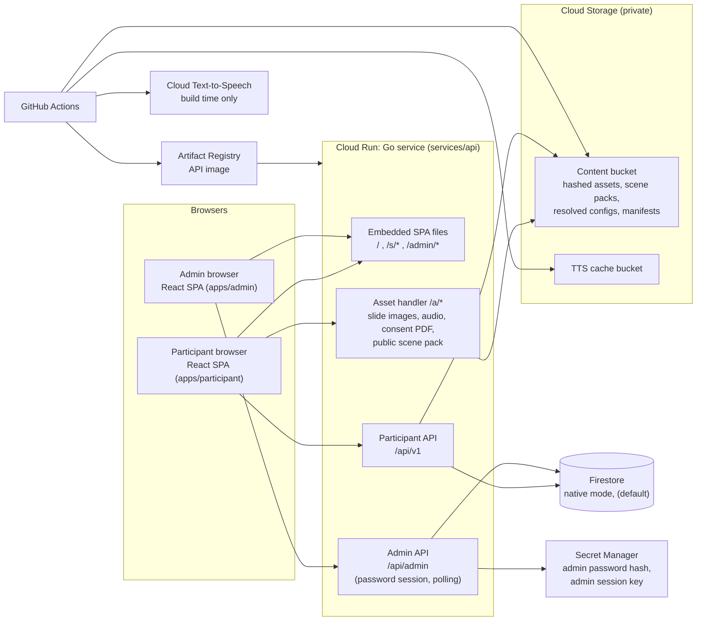
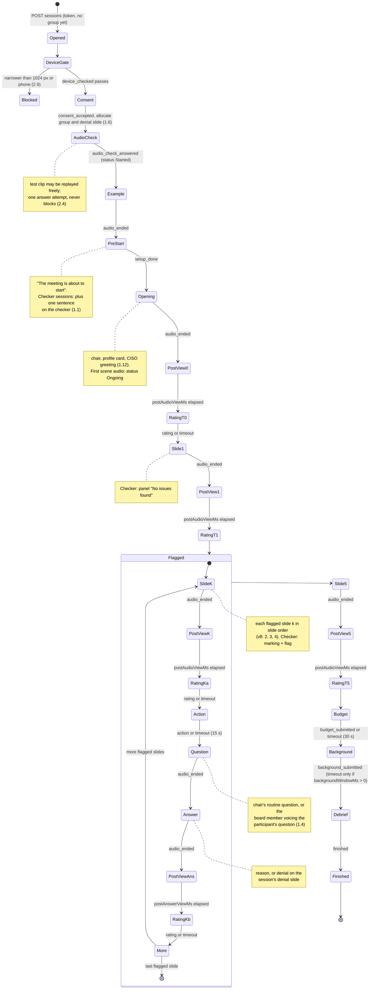
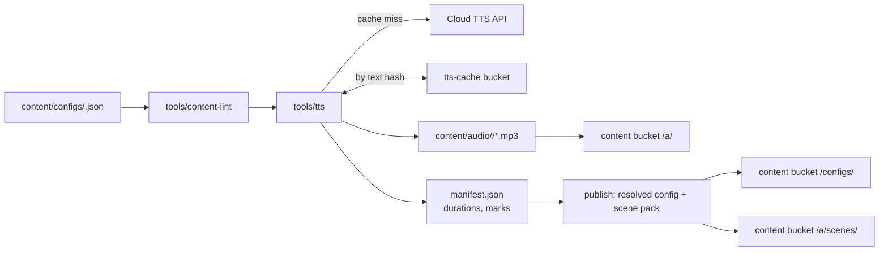

# Prototype architecture: browser-based boardroom study

Written 2026-10-23, revised 2026-10-24. Sources: `00 - Original Prompt (2026-10-23).md` (application shape), `01 - Study Flow Brief (Abstract v8 mapping).md` (flow and fixed constraints), `CMPT 863 Project Abstract v8.md` (study design), and `04 - Open Decisions.md`, where Oliver answered every open point on 2026-10-23 and 2026-10-24. Decision numbers such as "(1.6)" refer to that file. Three things are still open and keep a marker: the consent PDF and ethics text (OPEN M, placeholders until the SFU form arrives), the GCP project id and domain (OPEN Q, still to be named; the region is decided), and what the checker panel shows before a flag and when "No issues found" appears (C-3, brief defaults in use). Voice names are chosen by Oliver from generated samples (3.6); they are a pending task, not an open design point. Changes are listed in section 18.

## 1. Purpose and scope

The prototype runs the whole Abstract v8 study in a browser, without a researcher present. A participant opens a run link, consents, checks audio, watches the narrated CISO slides in a simulated boardroom (five in Abstract v8; the number is configuration), gives trust ratings, makes the budget decision and answers background questions.
The server allocates the group, enforces the order and timing of every step, and records each step as it happens.
An admin area, behind a shared password, creates run links per recruitment source, shows live progress and exports the data.
All slide content, markings, flag texts, colours, narration and timings are configuration, so the material can evolve without code changes.
Out of scope: analysis scripts, the ethics form itself (OPEN M), generated video (decided against: still composite with light animation, 2.10).

## 2. System overview

Everything is served by one Go service on Cloud Run (3.4). There is no load balancer, no Cloud CDN and no Identity-Aware Proxy.



Key points:

- One Go service serves the participant SPA, the admin SPA, the content assets and both APIs. Cloud Run ingress is "all"; TLS ends at Google's front end in front of Cloud Run.
- **Assets are read from a private GCS bucket by the service, not baked into the image.** Reason: content versions are published by CI and pinned per run (2.16); reading them from the bucket lets a new content version go live without a new image, and keeps code releases and content releases apart. The SPA bundles, which change only with code, are baked into the image with `go:embed`. Section 12.4 gives the caching headers.
- The admin area is protected by a shared password, stored as a hash in Secret Manager and checked by the Go service (3.2).
- Country is not recorded. The load balancer header that gave it is gone, and a GeoIP lookup in the service would need a licensed database for little gain; the raw IP address is stored (3.1), so a lookup can still be done offline at analysis time if it is ever needed.
- Text-to-Speech is called only by CI. Participants never trigger it.

## 3. Repository layout

The admin is a **separate Vite app** (`apps/admin`), not a route in the participant app. Reasons: the participant bundle stays small and holds no admin code, and the admin can show the full config (flags, denial mapping) without that content ever entering the participant bundle. The admin bundle itself holds no study content; it loads everything through the password-protected admin API. Shared types live in `packages/shared`.

```text
.
├── apps/
│   ├── participant/            React + Vite, built into services/api (go:embed)
│   │   └── src/{routes,scenes,slide,audio,api,timers}/
│   └── admin/                  React + Vite, built into services/api (go:embed)
│       └── src/{login,runs,participants,export,configs}/
├── packages/
│   └── shared/                 TS types: StudyConfig, API DTOs, step descriptors
├── services/
│   └── api/                    Go module
│       ├── cmd/api/            main.go (HTTP server: SPAs, assets, APIs)
│       ├── cmd/sweeper/        abandonment sweep (Cloud Run job)
│       ├── internal/http/      routing, middleware (session token, admin session, rate limit, client IP)
│       ├── internal/assets/    GCS-backed asset handler with in-memory cache and range requests
│       ├── internal/domain/    session plan compiler, state machine, timing rules, allocation
│       ├── internal/store/     Store interface and the firestore/ implementation
│       ├── internal/events/    event types, validation, append-only log writer
│       ├── internal/export/    CSV and JSON export
│       └── pkg/studyconfig/    Go types for the config + manifest (imported by tools/)
├── content/
│   ├── schema/                 study-config.schema.json (equivalent of the packages/shared types)
│   ├── configs/                <version>.json, versioned study configs, pinned per run (2.16)
│   ├── images/                 slide images, boardroom background, portraits ciso, chair, member (the participant's seat), member2 to member6 (silent board members); all optional
│   ├── consent/                consent PDF placeholder (OPEN M)
│   ├── vlm-drafts/             flag drafting runs with provenance (section 11.2)
│   └── audio/<version>/        generated MP3s (git-ignored) + manifest.json (committed)
├── tools/
│   ├── tts/                    Go CLI: config -> Google TTS -> MP3 + durations manifest
│   ├── render-slides/          Playwright script: slide layouts -> PNG for the VLM run
│   └── content-lint/           Go CLI: schema validation + wording rules
├── infra/terraform/
│   ├── modules/{project-services,artifact-registry,cloud-run,storage,
│   │            firestore,secrets,monitoring}/
│   └── envs/{dev,prod}/        backend config + tfvars, call the modules
├── e2e/                        Playwright tests, fast-timing test config
├── load/                       k6 script, 50 concurrent sessions
├── .github/workflows/          ci.yml, deploy.yml
├── docker-compose.yml
├── go.work
└── Makefile
```

`tools/tts` is Go so that it shares `pkg/studyconfig` with the server; the manifest the tool writes is the same type the server reads.

## 4. Content configuration model

### 4.1 Types

The source of truth is the TypeScript type set below in `packages/shared`. The JSON Schema `content/schema/study-config.schema.json` (draft 2020-12) is its exact equivalent; CI regenerates it from the types and fails if it differs from the committed file. The schema validates configs in CI, in the admin upload and at server start. Go mirrors the types in `pkg/studyconfig`, with a round-trip test on every config in `content/configs/`.

Two rules apply at every level:

- **Author notes.** Any object may carry extra keys that start with `_` (for example `_note`, `_source`, `_scenario`). The schema accepts them, and no tool, server or client reads them. Every other unknown key is an error.
- **Ids.** Every `Id` matches `^[A-Za-z0-9][A-Za-z0-9._-]*$` and is unique within the config.

Nothing in the types assumes particular slide topics. The deck's arc (what is going on, the risk and its impact, how we solve it, what it costs, the decision; 4.1 in the decisions file) is content, written with the generic blocks below.

```ts
type Ms = number;            // milliseconds, integer >= 0
type Id = string;            // stable, unique within a config
type Hex = string;           // "#RRGGBB"
type Group = "checker" | "neutral";
type RichText = string | Span[];          // plain text, or spans so a marking can hit one phrase
interface Span { id: Id; text: string }
interface Choice { id: Id; label: string }

interface StudyConfig {
  version: string;           // e.g. "1.3.0"; pinned per run, locked once a run uses it (2.16)
  locale: "en";
  timing: Timing;
  voices: Voices;            // US English (3.6)
  options: StudyOptions;
  labels: Labels;
  colors: Colors;
  consent: ConsentSpec;      // placeholder PDF until the ethics form arrives (OPEN M)
  setup: SetupSpec;
  rating: RatingSpec;
  actions: ActionSpec;
  scenes: Scene[];           // see "Scene order" below
}

interface Timing {
  postAudioViewMs: Ms;           // 10000, after the opening and after each slide, before the rating (1.8)
  postAnswerViewMs: Ms;          // 10000, after each CISO answer, before the second rating (1.8)
  ratingWindowMs: Ms;            // 15000
  actionWindowMs: Ms;            // 15000 (2.1)
  formWindowMs: Ms;              // 30000, for the budget screen (2.12)
  backgroundWindowMs?: Ms;       // 0 = untimed background screen (2.12 revised 2026-10-25); absent: formWindowMs
  linePauseMs: Ms;               // 600, silence tools/tts inserts where it joins lines into one clip
  audioEndToleranceMs: Ms;       // 1500, how early audio_ended may arrive
  latencyAllowanceMs: Ms;        // 3000, network allowance on window deadlines
  abandonAfterMs: Ms;            // 1800000, 30 min without events (2.13)
  msPerWordEstimate?: Ms;        // 400; only for `make tts-fake` and author estimates before real TTS
}

interface Voices {
  ciso: VoiceSpec;           // male (3.6)
  chair: VoiceSpec;          // clearly different from the CISO
  member: VoiceSpec;         // third board member, speaks the participant's chosen question (1.4)
}
interface VoiceSpec { provider: "google-tts"; name: string; languageCode: "en-US"; speakingRate?: number; pitch?: number }
// name: filled after Oliver picks from generated samples; the family must return SSML timing marks (3.6)

interface StudyOptions {
  deviceGate: { minWidthPx: number; allowPhones: boolean };  // 1024, false: desktop and landscape tablet (2.9)
}

interface Labels {           // shared interface wording, in one place
  panelTitle: string;        // "Slide checker"
  noIssues: string;          // "No issues found" (4.2)
  panelIdle: string;         // what the panel shows before a flag or label appears; brief default "" (C-3)
  ratingSubmit: string;      // "Next"
  timeLeft: string;          // "Time left"
  continue: string;          // "Continue"
  playTestSound: string;     // "Play test sound"
  replayTestSound: string;   // "Play again"
  startMeeting: string;      // "Start the meeting"
}
interface Colors { flag: Hex; noIssues: Hex }   // markings use colors.flag unless they set their own

interface ConsentSpec {      // placeholder until the SFU ethics form arrives (OPEN M)
  version: string;           // sent back in consent_accepted
  pdfAssetKey: string;       // file in content/consent/; must mention that the IP address is stored (3.1)
  checkboxLabel: string;
  acceptLabel: string;       // "I accept the terms and would like to participate in the study"
}

// ---------- audio ----------
interface AudioLine {
  id: Id;                    // human line id, e.g. "s2.answer.denial"; used in content, lint and the manifest only
  voice: "ciso" | "chair" | "member";
  text: string;              // plain text, shown to authors and used as the screen-reader transcript
  ssml?: string;             // optional, for pauses and <mark> anchors; lint rules in 4.2
  audioKey?: string;         // filled at publish: "<sha256 hex>.mp3"; authors leave it out
  durationMs?: Ms;           // filled at publish from the measured MP3
  marks?: Record<string, Ms>;// filled at publish: SSML mark name -> offset
}

interface SetupSpec {
  instruction: string;       // "Please turn on your sound ..."
  audioCheck: AudioCheck;
  exampleScene: { template?: LayoutTemplate; layout: Block[]; lines: AudioLine[] };  // playback check, same for both groups
  preStartText: { both: string[]; checker: string[] };
  // Last setup screen ("The meeting is about to start"). Both groups see `both`; checker sessions also see
  // `checker`, the one neutral sentence that introduces the checker (1.1, 4.3). No other checker introduction exists.
}
interface AudioCheck {
  clip: AudioLine;           // the only clip the participant may replay, as often as they like (2.4)
  prompt: string;            // "Which word did you hear?"
  options: Choice[];
  correctOptionId: Id;       // one answer attempt; right or wrong is recorded and shown in the admin view, never blocks (2.4)
}

// ---------- slides ----------
type LayoutTemplate = "auto" | "title-bullets" | "numbers" | "image-right" | "chart";
type Block =
  | { kind: "title"; id: Id; text: RichText }
  | { kind: "bullet"; id: Id; text: RichText }
  | { kind: "number"; id: Id; value: RichText; caption?: RichText }
  | { kind: "image"; id: Id; assetKey: string; alt: string }
  | { kind: "chart"; id: Id; chartType: "bar" | "line" | "timeline"; data: ChartData; alt: string; caption?: RichText };
interface ChartData {
  axis: { min: number; max: number; label?: string };
  series: { id: Id; label: string; value?: number; start?: number; end?: number; points?: number[] }[];
  markers?: { id: Id; at: number; label: string }[];   // e.g. a dashed "Ready" line
}
// A layout is rendered on a 1600 x 900 logical canvas, scaled to fit. Lint: exactly one "title" block, first.

interface Marking {
  id: Id;
  targetIds: Id[];           // one or more block, span, chart series or marker ids; one callout per marking
  bbox?: [x: number, y: number, w: number, h: number]; // fallback, slide coordinates
  appearAtMark?: string;     // preferred: an SSML <mark> name in the narration, resolved by tools/tts
  appearAtMs?: Ms;           // offset into the narration; used when no mark is set
  anchorText?: string;       // the narration phrase the flag belongs to; lint checks it occurs in the narration
  color?: Hex;               // default colors.flag
  shape: "box" | "underline" | "circle";
  label: string;             // from the VLM run, approved by Oliver (1.17, 4.1)
  detail: string;
  vlmRun?: string;           // directory under content/vlm-drafts/ this flag was drafted in (section 11.2)
}
// At least one of appearAtMark and appearAtMs is required; the mark wins when both are set.

type CheckerPanel =
  | { status: "noIssues"; appearAtMark?: string; appearAtMs?: Ms; text?: string }  // unflagged slide; text default labels.noIssues; timing C-3
  | { status: "flagged"; markings: Marking[] };                                     // flagged slide
// A slide is flagged exactly when checker.status is "flagged". The flagged set is whatever the config says.
// The panel is present on every CISO slide for checker sessions, not during the opening (1.18).

type Answers =
  | { mode: "whole"; reason: AudioLine; denial: AudioLine; padDenialToReason?: boolean }
  | { mode: "joined"; opening: AudioLine; reasonBody: AudioLine; closing: AudioLine; padDenialToReason?: boolean };
// "joined": tools/tts synthesises the three parts once and builds reason = opening + reasonBody + closing,
// denial = opening + closing, so the shared sentences are the same audio in both versions (section 11.1).
// padDenialToReason (default false): tools/tts appends silence to the end of the denial clip so that its duration
// equals the reason clip's duration. Rule (1.22): write the denial to the reason's length where that stays credible
// without a reason; set padDenialToReason only where it cannot.

// ---------- scenes ----------
type Scene =
  | OpeningScene | SlideScene | RatingScene | ActionScene
  | QuestionScene | AnswerScene | BudgetScene | BackgroundScene | DebriefScene;

interface OpeningScene {
  kind: "opening";
  id: Id;
  template?: LayoutTemplate;
  layout?: Block[];          // what the presentation screen shows; omit for an empty screen
  profileCard: ProfileCard;  // shown while the chair reads the profile (1.12)
  lines: AudioLine[];        // chair lines, the profile, then the CISO's greeting; joined into one clip at publish
}
interface ProfileCard { name: string; role: string; lines: string[]; portraitKey?: string; showFromLineId: Id }

interface SlideScene {
  kind: "slide";
  id: Id;                    // e.g. "s1"; the slide number n is its position among slide scenes (1, 2, 3, ...), any count
  template?: LayoutTemplate;
  layout: Block[];
  narration: AudioLine;      // voice "ciso"; about 110 words (1.7, content)
  checker: CheckerPanel;     // shown to the checker group only
  routineQuestion?: AudioLine;                                  // flagged slides; voice "chair"; slide-specific (1.10)
  participantQuestions?: { explain: AudioLine; challenge: AudioLine }; // flagged slides; voice "member" (1.4)
  answers?: Answers;                                            // flagged slides; voice "ciso"
}

type RatingPoint = string;   // pattern ^T(0|[1-9][0-9]*[ab]?)$, derived from the plan (see "Rating point ids" below)
interface RatingScene {
  kind: "rating";
  id: Id;
  point: RatingPoint;
  after: Id;                 // id of the scene it follows: "opening", a slide id, or an answer scene id
}
interface ActionScene   { kind: "action";   id: Id; forSlide: Id }  // one per flagged slide; options per group from `actions`
interface QuestionScene { kind: "question"; id: Id; forSlide: Id }  // audio: chair's routine question or the member voicing the participant's question
interface AnswerScene   { kind: "answer";   id: Id; forSlide: Id }  // audio: server plays reason or denial

interface BudgetScene {      // approve or reject, plus how sure (1.5); timed by formWindowMs (2.12)
  kind: "budget";
  id: Id;
  prompt: string;
  options: Choice[];         // e.g. approve, reject
  confidence: { label: string; scale: ScaleSpec };   // "How sure are you?" 0 to 10
}

interface BackgroundScene {  // all items at the end, after the budget decision (1.9); untimed when backgroundWindowMs is 0 (2.12, 2026-10-25)
  kind: "background";
  id: Id;
  intro: string;             // states plainly that this data is collected as part of the study; no mention of groups (4.6)
  preferNotToSayLabel: string; // "Prefer not to say", added by the renderer to every answerable item (2.14)
  items: BackgroundItem[];
}
type BackgroundItem =
  | { kind: "single";   id: Id; label: string; options: Choice[]; otherOptionId?: Id }
  | { kind: "scale";    id: Id; label: string; scale: ScaleSpec }
  | { kind: "country";  id: Id; label: string }
  | { kind: "honeypot"; id: Id; label: string };   // hidden field (2.3)

interface DebriefScene {
  kind: "debrief";
  id: Id;
  paragraphs: { both: string[]; checker: string[]; neutral: string[]; end: string[] }; // shown: both, own group, end
  doNotDiscuss: string;      // one sentence asking participants not to discuss the study while recruitment runs (2.15)
  sessionCodeLabel: string;  // "Your session code, if you want to withdraw:"; the code is always shown (2.14)
}

// ---------- measures ----------
interface RatingSpec {
  instruction: string;       // shown above the items
  items: RatingItem[];       // fixed order, trust first (1.23)
}
interface RatingItem {
  id: "trust" | "competence" | "benevolence" | "integrity";
  label?: string;            // trust: the question; the three METI items: omitted, the antonym ends carry the wording (1.13)
  scale: ScaleSpec;          // trust 0 to 10; the three METI items 1 to 7 antonym scales, e.g. incompetent / competent (1.13)
}
interface ScaleSpec { min: number; max: number; minLabel: string; maxLabel: string; pointLabels?: Record<string, string> }
// Every scale is shown as a row of clickable numbers with nothing preselected; untouched is recorded as missing (2.8).

interface ActionSpec {
  checker: { prompt: string; note?: string; options: { id: "nothing" | "explain" | "challenge"; label: string }[] };
  neutral: { prompt: string; note?: string; options: { id: "hasQuestion" | "noQuestion"; label: string }[] };
}
```

**Scene order.** The plan compiler (section 5.1) builds each session's steps from the canonical flow in section 5.2 and looks scenes up by `kind`, `id` and `forSlide`. The order of `scenes[]` is for readability; lint warns if it differs from the default flow. Scenes carry no group field: which group sees what is decided in the compiler.

**Rating point ids.** Every slide is followed by a rating, with a baseline after the opening (1.3). The ids follow from the slide order and the flagged set, so no list of points is fixed in code: `T0` is the baseline after the opening; `T<n>` follows unflagged slide n; `T<n>a` follows flagged slide n (after the flag); `T<n>b` follows the answer on flagged slide n. With the Abstract v8 content this gives T0, T1, T2a, T2b, T3a, T3b, T4a, T4b, T5. Authors write the `point` in each rating scene for readability; lint fails if it differs from the derived id.

**Number of slides and question rounds.** Nothing in the code assumes five slides or flags on slides 2 to 4. The number of slide scenes, which of them are flagged, and therefore the number of question rounds (one action, question, answer and second rating per flagged slide) all come from the config, so slides can be added after testing (1.24). Abstract v8's five slides with flags on 2, 3 and 4 is the default content, not a rule.

**Question and timeouts in actions (2.1).** The action window is 15 s. If the checker participant chooses "explain" or "challenge", the board member voice speaks that question; otherwise (say nothing, or a timeout) the chair asks the routine question. In the neutral group the chair asks the routine question whatever the answer. A timeout in either group is stored as `actionId: null, timedOut: true`, that is, as missing; it is never mapped to an option, so the analysis of H4a is not biased.

**Checker introduction.** There is no checker introduction screen and no role instruction screen (1.1, 4.3). Checker sessions see one extra neutral sentence (`setup.preStartText.checker`) on the last setup screen; the neutral group sees the same screen without it. Participants are told the checker is an AI only at the debrief (1.25).

### 4.2 Wording and asset lint

`tools/content-lint` runs in CI, in the admin config upload and before TTS. It ignores every `_` key. It fails the build if:

- a marking `label` or `detail` contains a word from a deny list (honest, honesty, dishonest, lie, lying, liar, deceive, mislead, truthful, trust) or any figure that reads as confidence or accuracy (`\d+\s*%`, "confidence", "accuracy", "probability", "certain", "likely to be correct");
- any `voice: "ciso"` line mentions AI (`\bAI\b`, LLM, "AI model", "language model", ChatGPT, "checker"). The bare word "model" is not on the list, because ordinary sentences use it;
- any text a participant sees before the debrief and that describes the checker (`labels`, marking `label` and `detail`, `setup.preStartText`) contains `\bAI\b`, "artificial intelligence", LLM, "language model" or "machine learning" (1.25);
- any CISO answer line (`reason`, `denial`, `opening`, `reasonBody`, `closing`) contains `<prosody>`, `<emphasis>` or a rate or pitch change, or the reason and denial of one slide use different SSML wrappers (the markup outside the spoken text must be identical);
- a flagged slide lacks `routineQuestion`, both participant questions or `answers`, or an unflagged slide has any of them;
- there is no slide scene, or no flagged slide;
- an action, question and answer scene do not exist exactly once for each flagged slide, or a `forSlide` names an unflagged slide;
- a slide, or an answer scene, is not followed by its rating scene, or the opening is not followed by `T0`;
- a `targetIds` entry does not exist in the slide layout, or a bbox lies outside 1600 x 900;
- a marking or noIssues panel has neither `appearAtMark` nor `appearAtMs`, an `appearAtMark` has no matching `<mark name>` in the narration SSML, or an `anchorText` does not occur in the narration text;
- `appearAtMs` (or the resolved mark) is later than the narration duration (checked after TTS);
- a rating `point` occurs twice or differs from the id derived from the plan;
- `correctOptionId` is not among the audio check options, the background scene has no honeypot item, or `debrief.doNotDiscuss` is empty;
- a source config sets `audioKey`, `durationMs` or `marks` (they are filled at publish);
- in a resolved config, any `audioKey` does not match `^[0-9a-f]{64}\.mp3$`;
- any asset filename (`audioKey`, `assetKey`, `portraitKey`, `pdfAssetKey`) contains `reason`, `denial`, `checker` or `neutral`, in any letter case.

It **warns**, without failing:

- with "differs from Abstract v8" when the number of slide scenes is not five, the number of flagged slides is not three, or the flagged slides are not 2, 3 and 4. A separate warning names the design limit: with fewer than three flagged slides a session cannot get at least two reasoned answers and one denial, which Abstract v8's design needs; with exactly one flagged slide there is no rotation (section 5.5);
- with "differs from Oliver's decisions" when the trust scale is not 0 to 10, a METI item is not 1 to 7, the item order is not trust, competence, benevolence, integrity, or the budget has other than two options;
- when a denial is more than 1,000 ms shorter than its reason after TTS and `padDenialToReason` is off (1.22);
- when a flagged marking has no `vlmRun`, or the slide layout has changed since that run (section 11.2). In `--strict` mode, used before a config is locked for a run, these two are errors.

The deny lists are config files in `tools/content-lint`, so they can be extended. A lint cannot judge tone; that review stays with the authors.

### 4.3 How the client gets group-specific content

The client never downloads the full config. Two artefacts are built from one config at publish, both stored in the private content bucket:

| Artefact | Served how | Contains |
|---|---|---|
| Public scene pack `scenes/<version>.json` | By the Go service at `/a/scenes/<version>.json`, no login | Only text that is the same for both groups and gives nothing away: slide layouts, image references, labels, setup (with `preStartText.both` only), consent, opening, rating instruction and items, budget and background forms. No markings, no panel texts, no questions or answers, no action options, no `preStartText.checker`, no debrief. |
| Full resolved config `configs/<version>.json` | Never served to participants; read by the service | Everything, with `audioKey`, `durationMs` and `marks` filled from the manifest. |

At each step the server returns a **step descriptor** (section 8). It names the scene, the audio URL to play, the deadlines, and, only for checker sessions, an `overlay` field: `{ status: "noIssues", text, appearAtMs }` on unflagged slides or `{ status: "flagged", markings }` on flagged slides. The same overlay comes with the slide's later steps until the next slide (post-audio view, action, question, answer, post-answer view; not the rating steps), so the panel and marks stay on screen while the question and answer refer to them. Neutral sessions get no `overlay` field at all. Action steps carry the option list for that session. Question and answer steps carry one audio URL, already chosen by the server. The checker sentence of the pre-start screen (`setup.preStartText.checker`) is delivered only in a checker session's descriptor for that step, and never in the public pack; the debrief paragraphs for the session's group come in the debrief step's descriptor. A participant who opens the network tab early therefore cannot read them. The response never contains a `group` or `denialSlide` field.

Audio files, images and the consent PDF are named by the SHA-256 of their content (audio: of its synthesis input), not by the human id, because a name such as `s2.answer.denial.mp3` in the browser's network tab would tell a participant which answer they got; that is why `id` and `audioKey` are separate fields and the lint enforces the hash pattern.

The participant bundle contains the panel component for everyone, so reading the code does not tell a participant their group. What a participant sees on screen is, of course, the group difference itself.

## 5. Participant session state machine

### 5.1 Session plan

At session creation the server writes a short plan with the steps every visitor gets (device gate, consent). When the group and denial slide are allocated at consent (section 5.5), it compiles the full **plan**: an ordered list of steps for this session, from the config, the group and the denial slide. The state machine then only has to check "is this event the one the current step expects, and is it on time". `progressTotal` is the number of participant-facing steps in the plan (server-only steps such as the post-audio view are not counted); `progressIndex` is the current one. This gives the admin k/N directly; before allocation N is shown as "-". The step list and N are computed from the config for the session's group: the number of slides, flagged slides and rating points all come from the config, so N changes between config versions. Both groups have the same steps; the checker sentence on the pre-start screen is text on an existing step, not a step, so N is the same for both groups of one config version. A run is pinned to one config version, locked once used (2.16), so k/N is comparable within a run, not necessarily across runs.

### 5.2 Diagram



The diagram shows the Abstract v8 content: one unflagged slide, the flagged slides, one unflagged slide. The compiler builds the same pattern for any slide list: each unflagged slide is slide, post-view and rating; each flagged slide is the Flagged block. Any non-final state moves to **Abandoned** when no event arrives for 30 minutes (`abandonAfterMs`, 2.13). Abandoned is a status, not a dead end: if the participant comes back before the plan's deadlines make it impossible, the session resumes, and an interrupted clip is replayed from the start (2.5, section 9.5).

The post-audio view (`postAudioViewMs` after the opening and each slide, `postAnswerViewMs` after an answer, 10 s each) is a server-timed state. The client shows the slide and moves to the rating at the deadline the server gave it; the server opens the rating window from its own clock.

### 5.3 Events the client sends

Every event carries `clientSeq` (1, 2, 3, ...), `type`, `clientTs` and `payload`. There are two sequences:

- **`clientSeq`** is the client's counter. The server accepts an event for processing only if `clientSeq = lastClientSeq + 1`. An event with that number is consumed whether validation then accepts or rejects it (for example `too_early`), so the next event uses the next number. A repeated `clientSeq` with an identical body is a retry: the server returns the stored result. A repeated `clientSeq` with a different body gets `duplicate_seq_mismatch`; any other number gets `seq_gap`. Neither of these two consumes a number.
- **`eventNo`** is the server's counter, `lastEventNo + 1`, and is the document id of every stored event: accepted, rejected (including `seq_gap` and `duplicate_seq_mismatch`) and server-written (synthetic timeouts). Client numbering never depends on what the server writes.

Every response, including errors, returns `expectedClientSeq`, and so does `GET /next`. The client always takes its next number from the last response, which also covers a reload.

All times below are server times. `d` is the clip duration from the resolved config, `tol` is `audioEndToleranceMs`, `lat` is `latencyAllowanceMs`. Every audio step (example, opening, slide, question, answer) plays exactly one clip: scenes with several lines and joined answers are concatenated into one MP3 at publish (section 11.1), so one `d` applies.

| Event | Payload | Expected step | Server validation |
|---|---|---|---|
| `device_checked` | `{ widthPx, heightPx, touch }` | DeviceGate | Width at least `deviceGate.minWidthPx`, landscape, not a phone (2.9). Failing moves to Blocked. |
| `consent_accepted` | `{ consentVersion, checkbox: true }` | Consent | `consentVersion` matches config. At least 3 s since step start (cannot accept unseen PDF instantly). Allocates group and denial slide (section 5.5) and compiles the plan. Sets `consentAt`. |
| `audio_check_played` | `{}` | AudioCheck, side event | Counts plays of the test clip; any number is allowed (2.4). |
| `audio_check_answered` | `{ choiceId }` | AudioCheck | At least one `audio_check_played` first. Accepted once; a second answer gets `wrong_state`. Records `correct: true/false` and the play count, shown in the admin view; a wrong answer adds flag `audio_check_wrong` and never blocks (2.3, 2.4). Sets status Started and `startedAt`. |
| `scene_started` | `{ sceneId }` | Example, opening, slide, question, answer | `sceneId` matches the plan. Starts the clip timer at server time `t0`. The client starts playback when this response arrives, not before, so `t0` is never later than the real start. A second `scene_started` for the same step is accepted only after a reload (section 9.5): it restarts `t0`, is stored as a restart and adds flag `reloaded`. The first `scene_started` of the opening sets status Ongoing. |
| `marking_shown` | `{ sceneId, markingId }` | Flagged slide, checker only | `now >= t0 + appearAt - tol`. Informational; does not advance the step. |
| `audio_ended` | `{ sceneId, afterProblem?: true }` | Same audio step | `now >= t0 + d - tol`. Earlier is rejected with `too_early`, stored `valid=false`, and the error carries `retryInMs = t0 + d - tol - now`; the client waits that long and sends `audio_ended` again with the next `clientSeq`. On success, after the opening, a slide or an answer it sets `ratingOpensAt = now + postAudioViewMs` (after an answer: `postAnswerViewMs`) and `ratingClosesAt = ratingOpensAt + ratingWindowMs`; after the example it moves to PreStart; after a question it moves to the answer. |
| `audio_problem` | `{ sceneId, kind: "error" or "stalled" or "noEnded", atMs }` | Same step, side event | Adds flag `audio_problem`; the session is kept (2.6). Does not advance. The response carries `continueInMs = max(0, t0 + d - now)`; the client shows "Continue" after that time, then sends `audio_ended` with `afterProblem: true`, which passes the normal duration check. |
| `setup_done` | `{}` | PreStart | At least 2 s on the screen. |
| `rating_submitted` | `{ point, trust, competence, benevolence, integrity }` | Rating | `point` matches the step (the descriptor gives it); `now >= ratingOpensAt - tol`; each value is an integer within its scale or `null` (not clicked). Accepted as on time up to `ratingClosesAt + lat`. A submission that arrives after lazy evaluation has closed the window finds a later step and is stored as a late side event (section 5.4). |
| `rating_timeout` | `{ point, partial: {...} }` | Rating | Client timer fired. Accepted only if `now >= ratingClosesAt - tol`. Partial answers are kept; the missing items are marked timed out (2.2). |
| `action_chosen` | `{ slideId, actionId }` | Action | `actionId` is in this session's option list. Accepted up to `actionOpenedAt + actionWindowMs + lat`. |
| `action_timeout` | `{ slideId }` | Action | `now >= actionOpenedAt + actionWindowMs - tol`. Stored as `actionId: null`, `timedOut: true` in both groups; the chair asks the routine question (2.1). |
| `budget_submitted` | `{ optionId, confidence }` | Budget | Shape matches the budget scene; either value may be `null`. Accepted up to `formOpenedAt + formWindowMs + lat` (2.12). |
| `budget_timeout` | `{ partial: {...} }` | Budget | `now >= formOpenedAt + formWindowMs - tol`. Partial kept, rest marked missing (2.12). |
| `background_submitted` | `{ items, hp }` | Background | Shape matches items; "Prefer not to say" is a valid answer for every item. Non-empty honeypot `hp` adds a flag (2.3). Same window rule as the budget. |
| `background_timeout` | `{ partial: {...}, hp }` | Background | As `budget_timeout`; rejected as `wrong_state` when the screen has no time limit (`backgroundWindowMs` 0, the default content since 2026-10-25). |
| `finished` | `{}` | Debrief | At least 5 s on the debrief. Sets status Finished. |
| `visibility` | `{ hidden: boolean }` | any | Side event, does not advance. Logged so tab switches during audio are visible to analysis. Max 30 per session. |

Side events (`audio_check_played`, `marking_shown`, `audio_problem`, `visibility`) use `clientSeq` like any other event.

Every response contains the next step descriptor and `expectedClientSeq`, so the client needs no extra call.

### 5.4 Timeouts when the client is silent

There is no deadline job per window. The server uses **lazy evaluation**: on every incoming event and every `GET /next`, it first walks the plan forward over expired deadlines. A window counts as expired only when `now > closesAt + latencyAllowanceMs`, so a submission sent just before the deadline and delayed by the network is still accepted on time. If a rating window expired and nothing arrived, the server writes a synthetic `rating_timeout` event with `source: "server"`, the next `eventNo` and `serverTs = ratingClosesAt`, then does the same for an expired action, budget or background window, and so on until it reaches a step with no expired deadline. Synthetic events take an `eventNo` but never a `clientSeq`, so the client's numbering is not disturbed. Audio steps have no deadline (the participant cannot be skipped past narration they did not hear).

A rating, action or form that arrives after its window has expired by this rule finds a later step. It is stored with `valid=false`, reason `late`, and its values, and the record keeps the status `timeout`; the export shows that a late submission exists.

A small Cloud Run job (`cmd/sweeper`), triggered by Cloud Scheduler every 5 minutes, sets status Abandoned on sessions whose `lastEventAt` is older than 30 minutes (2.13). It runs the same lazy evaluation first, so a session that timed out its last rating and then went silent shows the timeout in the data.

### 5.5 Group allocation and denial-slide balancing

Allocation happens at `consent_accepted`, which can only follow a passed device gate (1.6). Visitors blocked by the device gate and people who do not consent never take a slot. Abandoned sessions keep their slot; it is not freed (1.6). Round robin is global across all run links (1.19). Allocation runs in one Firestore transaction on the global counter document `counters/allocation`, which holds one group counter per group and, per group, one denial counter per flagged slide id of the config version:

1. Read the counter document.
2. Group: the group with the lower count; on a tie, the next in fixed order (checker, neutral). This is round robin as sign-ups arrive, as Abstract v8 says.
3. Denial slide: within the chosen group, the flagged slide with the lowest count; on a tie, the next in slide order after the group's last assigned denial slide. The rotation runs over the configured flagged slides in slide order (v8: s2, s3, s4), not over fixed numbers. With exactly one flagged slide there is no rotation: that slide always carries the denial, and no session hears a reasoned answer, so Abstract v8's design (at least two reasons and one denial) needs at least three flagged slides; the lint warns below three (section 4.2).
4. Increment both counters, write group and denial slide to the session, and compile the plan.

The counters balance allocated sessions, not completed ones; the admin view shows finished counts per group so any imbalance is visible. The group and denial slide are stored only on the server; the client sees their effects step by step, never the labels.

## 6. Anti-fabrication and bot resistance

The main defence is structural: a valid record can only be built one event at a time, in order, at the speed of the real audio. A full session cannot be posted faster than the narration plays (about 10 minutes, Abstract v8). Everything else raises the cost or flags suspicious sessions for the researcher. Flags never block and never exclude; exclusion rules are written into the analysis plan before data collection (1.20).

| Measure | Design |
|---|---|
| Session token | 256-bit random token, returned once at creation in an **HttpOnly, Secure, SameSite=Strict cookie** scoped to `/api/v1`. The server stores only its SHA-256. It survives a reload without JavaScript storage and cannot be read by injected script. Every participant call must also send `X-Study-Client: 1`, which a cross-site form cannot set, as a CSRF guard. |
| One event at a time | Firestore transaction per event: read session, check `clientSeq` and expected step, write the event under the next `eventNo`, update session. Concurrent events conflict and one is retried or rejected. |
| Server timestamps only | All windows and durations use `serverTs`. `clientTs` is stored for analysis of clock skew only. |
| Duration checks | Each audio step's end event must arrive no earlier than `d - tol` after its start (section 5.3). Durations come from the resolved config the server loads, not from the client. |
| Rate limiting | Per IP address: 5 session creations per hour, then new sessions are created but flagged; 30 per hour hard limit (429). Per session: 60 events per minute, 600 in total. Admin login: 5 attempts per 15 minutes per IP. In-memory token buckets per instance; with `max_instances` small this is close enough. |
| Client IP | Read from `X-Forwarded-For`. Clients can prepend fake entries, so the server trusts only the entry Google's front end appends in front of Cloud Run, the last element. Configured as `TRUSTED_PROXY_HOPS`; the raw header is logged for the first pilot sessions to confirm the setting. |
| IP storage | The raw IP address is stored on the session (3.1). The consent text must say so (OPEN M). Request logs keep it too, with a 7-day log bucket retention. No country and no ASN are derived (section 2). |
| User agent | Stored raw, plus parsed browser and OS family. |
| Honeypot | Hidden text field in the background form (`hp`), off-screen and `aria-hidden`, with `autocomplete="off"`. Filled means flag (2.3). |
| Audio-word check | Setup plays a word, which the participant may replay as often as they like; they pick it from four options once. A wrong answer is a flag, not a block (2.4). |
| Duplicate detection | Same IP address and same user agent within 60 minutes as another session: both sessions get flag `possible_duplicate`, shown in the admin view. Not blocked, because shared office or campus networks are common (1.21). A reload on the same browser resumes the existing session instead of creating a new one (cookie check at `POST /sessions`). |
| Invalid events | Every rejected event is stored with `valid=false` and a reason. More than 5 per session adds flag `many_invalid_events`. |

**What the admin sees**: a flags column with short chips (`possible_duplicate`, `honeypot`, `audio_check_wrong`, `audio_problem`, `many_invalid_events`, `rate_limited`, `tab_hidden_during_audio`, `reloaded`), and the audio check result. The detail view lists the session's full event timeline, including rejected events. The admin decides exclusions in the analysis; the system never deletes a flagged session.

**Residual risk**: none of this is perfect. A scripted headless browser that waits for each clip and gives plausible ratings is indistinguishable from a careless human. A person can take the study twice from a phone and a laptop on different networks. VPNs defeat IP checks, and shared networks cause false duplicate flags. The design makes fabrication slow (real time per fake session) and visible, not impossible. With 40 participants recruited from personal networks, the realistic risk is careless participation, which the attention checks and timing data help to spot.

## 7. Data model

### 7.1 Firestore collections

```text
runs/{runId}
  code            string   URL code, e.g. "k7m2qpv4xw8n" (unique, RUN_CODE_LENGTH chars, default 12, no look-alikes)
  name            string   "LinkedIn post 1"
  source          string   "LinkedIn", "WhatsApp", ...
  configVersion   string   pinned; cannot change once the run has sessions (2.16)
  status          "open" | "closed"
  createdAt, createdFromIp      (one shared admin password, so no per-person identity)

counters/allocation              global across runs (1.19)
  groups          { checker: n, neutral: n }
  denial          { checker: { <flaggedSlideId>: n, ... }, neutral: { ... } }   per config version's flagged slides
  lastDenial      { checker, neutral }

sessions/{sessionId}
  runId, runCode, source           (source copied for export)
  configVersion
  group           "checker" | "neutral" | null     null until consent (section 5.5)
  denialSlide     flagged slide id, e.g. "s3", or null before consent
  status          "Opened" | "Started" | "Ongoing" | "Finished" | "Abandoned" | "Blocked"
  currentState    step id from the plan, e.g. "s3.ratingA"
  plan            string[]          compiled steps
  progressIndex, progressTotal
  lastClientSeq   last client number consumed (section 5.3)
  lastEventNo     last stored event number
  deadlines       { ratingOpensAt?, ratingClosesAt?, actionClosesAt?, formClosesAt?, clipStartedAt? }
  openedAt, consentAt, startedAt, ongoingAt, finishedAt, lastEventAt, updatedAt
  audioCheck      { choiceId, correct, plays }
  reloadCount
  tokenHash
  ip, userAgent, uaFamily
  flags           string[]

sessions/{id}/events/{eventNo}    append-only, never updated; id zero-padded, e.g. "000042"
  eventNo, clientSeq (null for server-written events), type, source ("client" | "server")
  serverTs, clientTs
  payload
  stateBefore, stateAfter
  valid, reason                    reason e.g. "too_early", "late", "seq_gap", "restart"

sessions/{id}/ratings/{point}     derived ids, e.g. "T0", "T1", "T2a", "T2b" (section 4.1)
  point, slideId, phase ("baseline" | "afterSlide" | "afterAnswer")
  trust (0 to 10), competence, benevolence, integrity (1 to 7)   null if not clicked
  itemStatus      { trust: "answered" | "timedOut", ... }
  status ("complete" | "partial" | "timeout")
  lateEventNo     set if a late submission was stored after the timeout (section 5.4)
  openedAt, submittedAt, latencyMs

sessions/{id}/answers/{kind}      "background", "budget", "actions"
  actions: { <flaggedSlideId>: { actionId, timedOut, questionBy: "chair" | "member", answerType: "reason" | "denial" }, ... }
           actionId null on timeout, in both groups (2.1)
  budget, background: payload as submitted or partial at timeout, per-item status, submittedAt

configs/{version}
  version, sha256, gcsPath, scenePackPath, manifestPath
  status "draft" | "validated" | "locked"   (locked when a run with sessions uses it, 2.16)
  uploadedAt, lintReport
```

**Status mapping** (2.13): **Opened** from link opening until the audio check is answered; **Started** from then until the first scene audio (the opening's `scene_started`); **Ongoing** from then until `finished`; **Finished**; **Abandoned** after 30 minutes without events, set by the sweeper; **Blocked** by the device gate. Elapsed time on the admin screen is `(finishedAt or now) - consentAt`, shown as "-" before consent (2.11); the link-opening time `openedAt` is stored and exported as well.

Indexes (composite, declared in Terraform):

| Collection | Fields | Used by |
|---|---|---|
| sessions | `runId` asc, `openedAt` desc | participants list filtered by run |
| sessions | `status` asc, `lastEventAt` asc | sweeper |
| sessions | `updatedAt` asc | admin polling ("changed since") |
| sessions | `ip` asc, `openedAt` desc | duplicate check |
| runs | `code` asc | single-field, automatic |

Events are read by `eventNo` inside one session's subcollection, which needs no composite index. The Go code talks to an `internal/store.Store` interface (`CreateSession`, `ApplyEvent`, `ListSessions`, ...), with one Firestore implementation (3.3).

## 8. API contract

All bodies are JSON. Times are RFC 3339 UTC strings from the server; durations are milliseconds.

### 8.1 Participant API (`/api/v1`, session cookie + `X-Study-Client` header)

| Method and path | Auth | Request | Response |
|---|---|---|---|
| `POST /api/v1/runs/{code}/sessions` | none (rate limited) | `{ screen: { w, h }, tz }` | `201 { sessionId, configVersion, scenePackUrl, assetBaseUrl, expectedClientSeq: 1, next: Step }`, sets cookie. If a valid cookie for an unfinished session of this run exists: `200` with the same session and its current `expectedClientSeq` (resume). `404` unknown code, `410` run closed. |
| `POST /api/v1/sessions/{id}/events` | cookie | `{ clientSeq, type, clientTs, payload }` | `200 { accepted: true, eventNo, expectedClientSeq, next: Step }` or error (section 8.3), which also carries `expectedClientSeq`. |
| `GET /api/v1/sessions/{id}/next` | cookie | none | `200 { next: Step, expectedClientSeq, progress: { index, total } }` after lazy evaluation. Used on load and reload. |
| `GET /api/v1/healthz` | none | none | `200 { ok: true }`. Used by the uptime check (section 12.1). |

```ts
interface Step {
  stepId: string;                 // opaque, e.g. "p14"; not the internal state name
  scene: "deviceGate" | "consent" | "audioCheck" | "example" | "preStart" | "opening" | "slide" | "postView"
       | "rating" | "action" | "question" | "answer" | "budget" | "background" | "debrief" | "done";
  sceneRef?: string;              // id in the public scene pack (layout, texts)
  audioUrl?: string;              // hashed MP3 for this step
  replayable?: boolean;           // true only for the audio check clip (2.4)
  restart?: boolean;              // true if this audio step is replayed from the start after a reload (2.5)
  overlay?: { status: "noIssues"; text: string; appearAtMs: number }
          | { status: "flagged"; markings: ResolvedMarking[] };  // checker sessions only; appearAtMs resolved
  options?: { id: string; label: string }[];             // action step, per session
  point?: string;                 // rating step: the derived point to send back, e.g. "T2a"
  transcript?: string;            // text of the clip in this step, for screen readers only; no captions (2.7)
  preStartText?: string[];        // preStart step: preStartText.both, plus .checker for checker sessions (1.1)
  debrief?: { paragraphs: string[]; doNotDiscuss: string; sessionCode: string }; // both, own group, end (2.14, 2.15)
  opensInMs?: number;             // e.g. post-audio view remaining before rating opens
  closesInMs?: number;            // remaining window, from server deadline
  prefetch?: string[];            // next step's asset URLs
  resumed?: boolean;              // true if this step was reached by a reload
}
```

`ResolvedMarking` is a `Marking` without `appearAtMark`, `anchorText` and `vlmRun`, with `appearAtMs` resolved (from the SSML mark if one is set) and `color` filled from `colors.flag` if the marking sets none, so the client needs no manifest.

Relative `opensInMs` and `closesInMs` avoid trusting the client clock.

### 8.2 Admin API (`/api/admin`, shared password, 3.2)

Login: `POST /api/admin/login { password }`. The service compares the password with a bcrypt hash read from Secret Manager (`admin-password-hash`, cached for 5 minutes so a rotated secret takes effect without a redeploy). On success it sets an `admin` cookie: HttpOnly, Secure, SameSite=Strict, path `/api/admin`, valid 12 hours, holding a random session id signed with HMAC-SHA256 under `admin-session-key` (also in Secret Manager). Every other admin call needs that cookie and the header `X-Study-Admin: 1` as a CSRF guard. Login is rate limited (section 6). `POST /api/admin/logout` clears the cookie. Because the password is shared, the data records no per-person identity; `createdFromIp` is kept on runs.

| Method and path | Request | Response |
|---|---|---|
| `GET /api/admin/runs` | none | `[{ id, code, name, source, configVersion, status, createdAt, counts: { opened, started, ongoing, finished, abandoned, blocked }, finishedByGroup }]` |
| `POST /api/admin/runs` | `{ name, source, configVersion }` | `201 { id, code, url: "https://<host>/s/<code>" }` |
| `PATCH /api/admin/runs/{id}` | `{ name?, source?, status? }` | updated run. `configVersion` cannot change once the run has sessions (2.16). |
| `DELETE /api/admin/runs/{id}` | none | `204` only if no sessions, else `409`. |
| `GET /api/admin/participants` | query: `runId, status, group, flagged, updatedSince, limit, cursor` | `{ items: [{ sessionId, runCode, source, group, openedAt, consentAt, finishedAt, progress: { index, total }, status, lastStep, lastEventAt, audioCheck, reloadCount, flags }], cursor, serverTime }` |
| `GET /api/admin/participants/{id}` | none | session plus full event timeline, ratings, answers |
| `GET /api/admin/export` | query: `format=csv|json, runId?, includeInvalid?, includeIp?` | file download (section 8.4) |
| `GET /api/admin/configs` | none | config list with status and lint report |
| `POST /api/admin/configs` | config JSON | `201` validated and linted, stored as draft, or `422` with lint errors. Also `422` if any `audioKey` in the resolved config is missing from the content bucket (TTS runs only in CI). |
| `GET /api/admin/configs/{version}` | none | full config |

**Live updates: polling.** The admin page polls `GET /api/admin/participants?updatedSince=<serverTime>` every 5 seconds and merges the changed rows; the elapsed timer ticks in the browser from `consentAt`, so it looks live between polls. Reasons for Cloud Run: an SSE stream holds a request open, which keeps an instance busy and billed for the whole time the admin tab is open and is cut at the request timeout, so it needs reconnect logic anyway; with more than one instance, each stream would need its own Firestore listener. With one or two admins and 40 participants, a 5 s poll costs a few thousand small reads a day, well inside the Firestore free tier.

### 8.3 Error format

```json
{ "error": { "code": "too_early", "message": "audio_ended arrived 4200 ms before the clip could end", "retryable": true, "retryInMs": 4200, "expectedClientSeq": 18, "next": { "...": "current Step" } } }
```

| HTTP | Codes |
|---|---|
| 400 | `bad_request`, `bad_payload` |
| 401 | `no_session`, `bad_token`, `admin_login_required`, `bad_password` |
| 404 / 410 | `unknown_run`, `run_closed` |
| 409 | `wrong_state`, `seq_gap`, `duplicate_seq_mismatch`, `late` |
| 422 | `too_early` (`retryable: true` with `retryInMs`), `out_of_range`, `lint_failed`, `missing_audio` |
| 429 | `rate_limited` |
| 500 / 503 | `internal`, `unavailable` (`retryable: true`) |

State errors always include `next` and `expectedClientSeq`, so a confused client can recover.

### 8.4 Export

CSV: **one row per rating point**, with the point id as a column and session columns repeated, so a config with more slides or flagged slides adds rows, never columns. Per-slide answers (action, who asked, answer type) sit on the rows of that slide's points. Columns: `sessionId, runCode, source, configVersion, group, denialSlide, status, openedAt, consentAt, startedAt, finishedAt, durationSec (from consent), audioCheckCorrect, audioCheckPlays, reloadCount, flags, point, slideId, phase, isDenialSlide, trust, competence, benevolence, integrity, trustStatus, competenceStatus, benevolenceStatus, integrityStatus, ratingStatus, lateSubmission, latencyMs, actionAtSlide, actionTimedOut, questionBy, answerType, budgetChoice, budgetConfidence, budgetStatus, background fields (one column per item id), backgroundStatus`, and `ip` only with `includeIp=true`. JSON: one object per session with nested ratings, answers and the full event log. The export reads from Firestore at request time; for 40 sessions this is a few hundred document reads.

## 9. Participant front end

### 9.1 Routes

All served by the Go service from the embedded participant bundle; any path under `/s/` returns `index.html`, so no rewrite rule is needed.

| Route | Content |
|---|---|
| `/s/:code` | Entry. Creates or resumes the session, then renders whatever `next.scene` says. All later screens live under this one route; the server, not the URL, decides the screen. No back navigation: the History API state is replaced, not pushed. |
| `/s/:code/blocked` | Device gate message: "please open this link on a computer or a tablet in landscape" (2.9). |
| `/` and others | Neutral "study link needed" page. |

### 9.2 Components

- **`<StepRouter>`** maps `next.scene` to a scene component and owns the `clientSeq` counter. It never counts on its own: it sets the counter from `expectedClientSeq` in every response (success or error) and in `GET /next`.
- **`<BoardroomScene>`**: a fixed 16:9 stage, scaled to the viewport, as a still composite with light animation (2.10). Layers: boardroom background image; the presentation screen with `<SlideRenderer>`; the CISO portrait, which gets a soft glow and a subtle speaking indicator while CISO audio plays; the chair portrait; the participant's own seat, captioned "Board member (You)" with a badge and a lighter frame, lit while the board-member voice speaks the participant's question; five more silent board members so the table looks full (2026-10-25); and, for checker sessions on CISO slides, `<CheckerOverlay>`.
- **`<SlideRenderer>`** renders a slide layout on a 1600 x 900 logical canvas. Every block, span and chart series gets `data-seg-id`, so the overlay can find its box with `getBoundingClientRect` and convert it to slide coordinates. If a target is missing it falls back to `bbox`.
- **`<CheckerOverlay>`**: the checker highlights the slide itself while the CISO talks (1.16); the neutral group sees the identical scene without highlighting. It is present from the first CISO slide, not during the opening (1.18). `noIssues` shows a tick and "No issues found" at its time. Before a flag or label, the panel shows `labels.panelIdle` (C-3). `flagged` draws each marking at its resolved `appearAtMs` (from the audio element's `currentTime`, not a separate timer), over all its `targetIds`, with a short draw-on animation in the configured colour, then shows one `label` and `detail` callout per marking. It sends `marking_shown` once per marking id.
- **`<AudioCheck>`**: play button, then "Play again" as often as wanted (each play sends `audio_check_played`), then the four word choices; one choice is final (2.4).
- **`<PreStart>`**: "The meeting is about to start" with the `preStartText` lines from the descriptor and the "Start the meeting" button.
- **`<RatingPanel>`**: the instruction and four items in fixed order (1.23). Each item is a row of clickable numbers, 0 to 10 for trust and 1 to 7 for the three antonym items with the two antonyms at the ends (1.13). Nothing is preselected; an item not clicked is sent as `null` (2.8). The rows are native radio groups styled as buttons, so they are keyboard accessible. A countdown bar and a submit button. On submit or at `closesInMs` it sends `rating_submitted` or `rating_timeout` with the `point` from the descriptor and what was given.
- **`<ActionPanel>`** (15 s countdown), **`<BudgetForm>`** (approve or reject, then "How sure are you?" 0 to 10 as clickable numbers, 30 s countdown), **`<BackgroundForm>`** (every answerable item with "Prefer not to say", honeypot field, 30 s countdown), **`<Debrief>`** (paragraphs, the do-not-discuss sentence, the session code).
- **`<ConsentPage>`**: inline PDF in an `<iframe>` (browser viewer) with a download link as fallback; checkbox; the accept button is disabled until the box is ticked (placeholder PDF, OPEN M).

### 9.3 Audio

- Exactly one `HTMLAudioElement` for the whole page life; each step swaps its `src`. No `controls` attribute, no keyboard shortcut, no seek. `pause` from the OS media keys is caught and resumed; the Media Session API handlers are set to no-ops.
- The next step's clip is prefetched from `prefetch` with `fetch()` into the HTTP cache (the MP3s are immutable and cacheable), not into a second audio element. Reason: Chrome unlocks playback for the whole page after one gesture, but Safari unlocks per media element, so a fresh second element may refuse `play()`. If one element proves unreliable, the fallback is to play everything through one Web Audio `AudioContext` unlocked at setup.
- Autoplay: the audio check's "Play test sound" click is the gesture that unlocks the one element.
- Playback starts when the `scene_started` response arrives (section 5.3).
- The `ended` event triggers `audio_ended`. On `too_early` the client waits `retryInMs` and sends it again. If `ended` does not fire within `d + 5 s`, or `error` / `stalled` fires, the client sends `audio_problem`, shows a "Continue" button that becomes active after `continueInMs` (the clip's length has passed), and then sends `audio_ended` with `afterProblem: true`. The session is flagged and kept (2.6).
- Replay: only the audio check clip can be replayed by the participant (2.4). Any other clip is played once, except that a reload replays the interrupted clip from the start (2.5, section 9.5).

### 9.4 Timers

The client shows countdowns from `opensInMs` and `closesInMs`. All deadlines are also enforced on the server (section 5.3); a manipulated client timer only produces rejected or late events.

### 9.5 Reload and resume

On load the app calls `GET /next`. The server applies lazy evaluation, then returns the current step with `resumed: true` and `expectedClientSeq`, from which `<StepRouter>` continues numbering. Every reload increments `reloadCount` and adds flag `reloaded` on the session record (2.5).

- **During an audio step** (clip started, not ended): the step comes back with `restart: true`. A reload loses the autoplay permission, so the client first shows "Continue" (a new gesture), then sends `scene_started` again; the server accepts this one repeat, restarts `t0`, and the clip plays from the start (2.5). Markings are shown again at their times.
- **During a post-audio view or a timed window** (rating, action, budget, background): the server's deadlines keep running; the client resumes with the remaining time, or lazy evaluation has already recorded the timeout.
- **On any other step**: the step is shown again as it was.

### 9.6 Device gate and accessibility

Device gate (2.9): width at least 1,024 px, landscape, not a phone; desktop and landscape tablets pass. Phones get a "please open on a larger screen" page that keeps the link for later. Accessibility minimums: WCAG 2.1 AA contrast for text and panel; all controls keyboard reachable with visible focus; rating and budget scales are native radio groups with labels; marking colours are paired with a shape so colour is not the only cue. There are no captions on screen; the transcript of each clip is available to screen readers only (2.7).

## 10. Admin front end

- **Login**: one password field (section 8.2). After 12 hours, or on logout, the admin logs in again.
- **Runs tab**: table of runs (name, source, code, config version, status, counts per status, finished per group). "New run" form: name, source (free text with suggestions LinkedIn, WhatsApp, Email, Other), config version (only validated versions; the run is pinned to it). After creation it shows the run link `https://<host>/s/<code>`, a copy button and a QR code (generated in the browser, downloadable as PNG). Close and reopen a run.
- **Participants tab**: columns session (short id), run, source, group, opened at, consent at (local time), progress k/N, status (Opened, Started, Ongoing, Finished, Abandoned, Blocked), elapsed since consent (live while running, fixed when Finished), last step, audio check (right or wrong, number of plays), reloads, flags including `possible_duplicate`. Filters: run, status, group, flagged only. Polls every 5 s (section 8.2). Row click opens the event timeline.
- **Export tab**: format CSV or JSON, run filter, include invalid events, include IP address. Downloads from `/api/admin/export`.
- **Config versions tab**: list of versions with status and lint report; upload a JSON file; view a version with a slide preview (the same `<SlideRenderer>` and `<CheckerOverlay>` imported from `packages/shared`), so the researcher can check markings without running a session. The preview also has a "no overlay" mode at exactly 1600 x 900, which `tools/render-slides` uses (section 11.2).

## 11. Content pipeline

### 11.1 Text-to-speech



1. The tool reads the config and collects every `AudioLine`: setup clips, opening, narration, routine questions, the participant questions in the board member voice (two per flagged slide, six with the v8 content, 1.4), and answers or answer parts. It works with the human line `id` throughout; the manifest maps each `id` to its hash file.
2. Cache key: `sha256(voice spec + text or SSML + audio config + tool version)`. The MP3 is named `<key>.mp3`, 64 hex characters. If the key exists in the cache bucket, it is copied, not regenerated. Files are named by hash and never by line id, because the participant's browser shows every file name it loads, and a name like `s2.answer.denial.mp3` would reveal the condition (section 4.3).
3. On a miss it calls `text:synthesize` with the voice from `voices` (US English, names chosen by Oliver from generated samples, 3.6) and `audioEncoding: MP3`. If the line has `<mark>` tags, it uses the `v1beta1` endpoint with `enableTimePointing: ["SSML_MARK"]` and stores the returned offsets in `marks`; `appearAtMark` on a marking is resolved from these. Voices are chosen from a family that returns marks (3.6); the tool still fails loudly if a mark is requested and none comes back. A `make voice-samples` target synthesises one fixed paragraph per candidate voice for the listening test.
4. Duration: measured from the MP3 itself with `ffprobe`, not estimated from text. Stored in the manifest in milliseconds.
5. SSML pauses: `<break time="600ms"/>` inside a line is part of the clip and its duration. A plain-text line is wrapped in `<speak>` with XML escaping, so "&" in a line does not break synthesis.
6. Joining: every scene plays exactly one clip (section 5.3). For a scene with several lines (the opening, the example scene) the tool concatenates the line MP3s with `timing.linePauseMs` of silence between them (`ffmpeg` concat, same sample rate and encoding), names the result by the hash of its parts, measures its duration, and records each line's start offset in the manifest, so the profile card can appear at `showFromLineId`.
7. Same voice for reason and denial (Abstract v8). The lint in section 4.2 forbids prosody, emphasis and rate changes in answer lines and requires the same SSML wrapper for both. TTS still renders a shared sentence slightly differently depending on what follows it. With `answers.mode = "joined"`, the tool synthesises the shared opening sentence, the reason body and the shared closing sentence as three separate clips and joins them into reason = opening + body + closing and denial = opening + closing, so the shared sentences are the same audio in both versions. With `mode = "whole"`, each answer is one synthesis. The choice is the content author's; `"joined"` gives the stronger guarantee.
8. Denial length (1.22): if `padDenialToReason` is set on a slide's answers, the tool appends silence to the end of the denial clip until its duration equals the reason clip's duration, then measures the result again. The padded file gets its own hash, so its name says nothing. Without the flag the clips are left as they are and the lint warns when the denial is more than 1 s shorter.
9. Output: `content/audio/<version>/manifest.json` (committed) and the MP3s (git-ignored, cache in GCS). The publish step renames images and the consent PDF to the hash of their content, writes the resolved config (every `audioKey` a hash, checked by the lint) and the scene pack, uploads everything to the private content bucket, and fails if any uploaded file name contains `reason`, `denial`, `checker` or `neutral`.
10. The server loads the resolved config for each run's version at start (and on first use of a new version) and uses `durationMs` for every timing check in section 5.3.

### 11.2 Drafting the flags with a VLM

Abstract v8 says the flags were drafted with a real vision-language model from images of the slides, and the debrief tells participants so. The drafting run uses a Claude Opus agent as the VLM (1.17). It is a manual content step, run once per slide content version, before the flags are written into the config:

1. **Render.** `tools/render-slides` opens the admin preview in "no overlay" mode with Playwright and saves each slide as a 1600 x 900 PNG. The images are what the VLM sees; they carry no markings.
2. **Prompt.** One fixed prompt, identical for every slide, asks the model to review the slide as a checker for a board member and to list possible issues as short observations about the slide. The prompt is written once and stored; it is not changed between slides.
3. **Run.** A Claude Opus agent receives the prompt and one slide image at a time, in a fresh context per slide, with no other material.
4. **Store provenance** under `content/vlm-drafts/<YYYY-MM-DD>-<configVersion>/`:
   - `slides/<slideId>.png`, the images as sent;
   - `prompt.md`, the exact prompt;
   - `run.json`: the model id exactly as reported by the API, date and time, who ran it, the SHA-256 of the prompt and of each image, and the SHA-256 of each slide's layout in the config;
   - `raw/<slideId>.txt`, the unedited output per slide;
   - `selection.md`: per flagged slide, which drafted flag was chosen, its original wording, the edited wording, and the reason for each edit. Oliver approves the final labels (4.1).
5. **Link.** Each flagged marking in the config sets `vlmRun` to that directory. The lint warns if `vlmRun` is missing or if a slide's layout hash no longer matches `run.json` (the slide changed after drafting), and fails on both in `--strict` mode before a config is locked for a run.

The drafting run produces content only; nothing in the running study calls a model.

## 12. Infrastructure and Terraform

### 12.1 Modules

| Module | Creates | Key variables |
|---|---|---|
| `project-services` | Enables run, firestore, storage, secretmanager, artifactregistry, texttospeech, cloudscheduler, monitoring, logging APIs | `project_id` (still to be named, OPEN Q) |
| `artifact-registry` | Docker repository, cleanup policy (keep last 10 images) | `region` |
| `cloud-run` | Cloud Run service (ingress all, public invoker, since the service does its own auth), runtime service account, Cloud Run job `sweeper` with Cloud Scheduler trigger and invoker account, and a domain mapping when `domain` is set | `region`, `image_digest`, `min_instances`, `max_instances` (default 3), `cpu`, `memory`, `domain` (still to be named, OPEN Q), env vars |
| `storage` | Private content bucket (uniform access, no public access), TTS cache bucket, log bucket with 7-day retention | `region` |
| `firestore` | Firestore database in native mode, named `(default)` so the free tier applies, composite indexes (section 7.1), daily backup schedule kept 7 days plus weekly backup kept 14 weeks, TTL policy off | `firestore_location`, default = `region`; fixed once created (3.5) |
| `secrets` | Secrets `admin-password-hash` and `admin-session-key` (values set out of band), accessor bindings for the runtime SA | none |
| `monitoring` | Uptime check on `https://<host>/api/v1/healthz`, alert on 5xx rate and on rejected-event spikes (log-based metric), notification channel; billing budget with 50/90/100 % alerts if the apply account has billing rights, otherwise created by hand | `alert_email`, `budget_amount` |

**Region** (3.5): `region` is a Terraform variable with default `northamerica-northeast1` (Montreal), the closest region to Vancouver on Oliver's choice, so it can be changed. The Firestore location is fixed once the database is created; changing it later means a new database and moving the data.

**Domain** (OPEN Q): until a domain is named, the service is reached at its `run.app` URL. A custom domain uses a Cloud Run domain mapping with a Google-managed certificate and DNS records at whoever hosts the domain. Domain mappings are not available in every region and have been a preview feature; this must be checked for the chosen region before relying on it. If they are not available, the fallback is a load balancer just for the domain, which brings back its fixed monthly cost.

### 12.2 Environments

`infra/terraform/envs/dev` and `envs/prod` each have their own backend prefix in a GCS state bucket and their own `terraform.tfvars`. Recommended over workspaces because the environment is visible in the path and a wrong `terraform workspace select` cannot apply dev settings to prod. Ideally dev and prod are separate GCP projects (project ids still to be named, OPEN Q).

### 12.3 Service accounts and IAM

| Account | Roles (scoped to resource where possible) |
|---|---|
| `api-runtime` | `datastore.user`; `storage.objectViewer` on the content bucket; `secretmanager.secretAccessor` on `admin-password-hash` and `admin-session-key`; `logging.logWriter`; `monitoring.metricWriter` |
| `sweeper-runtime` | `datastore.user`; `logging.logWriter` |
| `scheduler-invoker` | `run.invoker` on the sweeper job, used by Cloud Scheduler to start it |
| `ci-deploy` (GitHub OIDC via Workload Identity Federation, no keys) | `artifactregistry.writer` on the repo; `storage.objectAdmin` on the content and cache buckets; `run.developer`; `iam.serviceAccountUser` on the runtime SAs; `serviceusage.serviceUsageConsumer` for TTS |
| `ci-terraform-plan` | `viewer`, `iam.securityReviewer`, `storage.objectUser` on the state bucket prefix, because `terraform plan` with the GCS backend writes a lock object (read-only access fails). Alternative: run plan with `-lock=false` in CI and keep read-only access |
| `ci-terraform-apply` | the admin roles Terraform needs, used only from `main` with a protected GitHub environment |

### 12.4 Settings worth stating

- **Cloud Run min instances**: `min_instances = 0` costs nothing when idle but a cold start (Go, about 1 to 2 s) could hit the first participant request. Within a session, gaps between events are under 30 s, so an instance usually stays warm, but not guaranteed. Recommendation: a tfvar, `1` during active recruitment, `0` otherwise. CPU allocated only during requests, 1 vCPU, 512 MiB, concurrency 80, request timeout 60 s.
- **Asset serving** (`internal/assets`): requests under `/a/` are read from the content bucket and kept in an in-memory cache per instance (a content version is about 15 to 30 MB, so one or two versions fit easily in 512 MiB). Responses use Go's `http.ServeContent`, which supports byte ranges (Safari requests audio in ranges), `ETag` and `If-None-Match`. JSON and HTML are sent gzip-compressed.
- **Caching headers set by the service**: hashed files (MP3s, images, consent PDF, the hashed SPA bundle files): `Cache-Control: public, max-age=31536000, immutable`. `index.html` of both SPAs: `Cache-Control: no-cache`. Scene pack JSON: `Cache-Control: no-cache` with an `ETag`, so a draft that is replaced before it is locked is never served stale. All `/api/` responses: `Cache-Control: no-store`.
- **Firestore**: native mode, database `(default)`, location the region variable (northamerica-northeast1 by default), point-in-time recovery on (7 days). Scheduled backups: daily kept 7 days (the maximum for a daily schedule) plus weekly kept 14 weeks.
- **Admin password**: the bcrypt hash is created locally (`make admin-password`) and added as a new version of `admin-password-hash`; the password itself is never stored. Rotating it means adding a new version; the service picks it up within 5 minutes.
- **Logging**: structured JSON logs; request logs in a bucket with 7-day retention; event data lives in Firestore, not in logs.

### 12.5 Rough monthly cost, 40 participants

| Item | Estimate (USD/month) | Note |
|---|---|---|
| Cloud Run, min 0 | under 1 | Free tier covers requests and CPU |
| Cloud Run, min 1 (if kept all month) | about 10 | Idle instance pricing; only during recruitment |
| Network egress from Cloud Run | under 1 | About 15 MB of assets per session, under 1 GB a month; check the free egress allowance for the region |
| Firestore | 0 | Well inside the free tier |
| Cloud Storage | under 1 | |
| Text-to-Speech | 0 to 1 | A few thousand characters per config version, plus voice samples |
| Secret Manager, Scheduler, Artifact Registry | about 1 | |
| Monitoring and logging | 0 | Free tier |
| **Total** | **about 1 to 13** | No load balancer cost any more (3.4). Check with the GCP pricing calculator for the chosen region |

## 13. CI/CD

GitHub Actions with Workload Identity Federation.

**`ci.yml`, on every pull request:**

1. `pnpm install`, typecheck, ESLint, Vitest for `apps/*` and `packages/shared`.
2. `go vet`, `go test ./...` for `services/api` and `tools/*`.
3. Content: generate JSON Schema from the TS types and fail if it differs from the committed `content/schema/study-config.schema.json`; validate and lint every config in `content/configs/` and every `content/study-config.*.json`.
4. Playwright end-to-end against the Firestore emulator with the fast test config, in Chromium and WebKit.
5. `terraform fmt -check`, `validate`, and `plan` for dev and prod, posted as a PR comment.

**`deploy.yml`, on push to `main`:**

1. Path filter: if `content/**` changed, run `tools/tts` (cache makes unchanged lines free), then publish hashed assets, resolved config and scene pack to the content bucket (section 11.1).
2. Build both SPAs and embed them in the Go image.
3. Build the Go image, push to Artifact Registry, record its digest.
4. `terraform apply` for dev with the new `image_digest`. Prod uses the same artifacts and needs manual approval in a protected environment.
5. Smoke test: `GET /api/v1/healthz` on the service URL, and create plus delete a test run in dev.

Configs are immutable once locked, content assets are named by hash, and sessions keep their state in Firestore, so a new Cloud Run revision or a new content version does not disturb a participant mid-session. Still, avoid deploys to prod during a planned recruitment window.

## 14. Local development

`make dev` starts `docker-compose.yml`:

| Service | What |
|---|---|
| `firestore` | `gcloud` emulator image, port 8080 |
| `api` | Go with `air` for reload (plain `go run ./cmd/api` also works); `FIRESTORE_EMULATOR_HOST` set; `CONTENT_DIR=./content/build` instead of the bucket; `ADMIN_PASSWORD=dev` instead of Secret Manager; `TRUSTED_PROXY_HOPS=0` |
| `participant` | Vite dev server on 5173, proxying `/api` and `/a` to the API |
| `admin` | Vite dev server on 5174, proxying `/api/admin` to the API |

`make tts-fake` writes silent MP3s with a duration estimated from `timing.msPerWordEstimate` (`ffmpeg anullsrc`) and a manifest, so a developer needs no GCP credentials. `make seed` creates a dev run and loads the example config.

## 15. Testing

- **Go unit tests** (`internal/domain`): table-driven tests for the plan compiler (both groups, configs with different slide counts and flagged sets, identical steps for both groups), every event against every state (wrong event, `seq_gap`, identical and mismatched retries, a rejected event followed by the next `clientSeq`, synthetic timeouts between client events, `expectedClientSeq` after a reload), timing rules with an injected clock (too early by 1 ms, on time, late within and beyond `latencyAllowanceMs`, `too_early` with `retryInMs` and the resend), lazy timeout evaluation across several expired deadlines (a window expires only at `closesAt + latencyAllowanceMs`), the one allowed `scene_started` repeat after a reload, the audio check answered twice, and allocation at consent balanced over 1,000 simulated sign-ups (group difference at most 1, denial slides per group differ by at most 1).
- **Store tests** against the Firestore emulator, including concurrent events on one session.
- **HTTP tests**: admin login (right, wrong, rate limited), cookie and CSRF header checks, asset handler (range requests, cache headers, unknown file), `X-Forwarded-For` parsing.
- **Content tests**: lint rules with good and bad examples; schema round trip Go to TS; the committed schema accepts `_` keys at every level and rejects other unknown keys; denial padding gives equal durations.
- **Playwright end-to-end**: a test config `e2e/config-fast.json` with 300 ms silent clips, `postAudioViewMs: 500`, `ratingWindowMs: 2000`, `formWindowMs: 3000`. Accepted only when the server runs with `ALLOW_TEST_CONFIGS=true`, which is false in prod. Scenarios: full checker session, full neutral session, the audio check clip replayed, a rating timeout with partial answers, an action timeout, budget and background timeouts, a reload mid-slide (clip replays from the start, flag `reloaded`), an early `audio_ended` forged through the API (expect 422), a stalled clip with "Continue", and the admin list showing status and progress. Runs in Chromium and WebKit (desktop Safari's audio unlock differs, section 9.3).
- **Load test** (`load/k6`): 50 concurrent sessions on dev with the fast config, each sending events at real relative pacing. Pass criteria: p95 event latency under 300 ms, no lost or duplicated events, groups 25/25 and denial slides balanced, no transaction errors beyond retries.

## 16. Delivery phases

| Phase | Scope | Working days |
|---|---|---|
| 1. Vertical slice | Monorepo, docker compose, Firestore emulator; Go service serving the SPA and assets; one opening line, one slide with one marking, one rating; session creation, consent with allocation; event endpoint with state and timing checks; event log; admin participants list with password login; fake TTS | 5 to 6 |
| 2. Full flow, both groups | Plan compiler, all scenes and events, lazy timeouts and sweeper, consent, setup with audio check and pre-start screen, budget and background with timers, debrief; real TTS tool with cache, manifest, joining and padding; voice samples; slide render tool for the VLM run; content lint; reload and replay; Playwright for both groups | 8 to 10 |
| 3. Admin polish and export | Runs tab with link, copy and QR; live polling and timers; flags, audio check result and event timeline; CSV and JSON export; config upload and preview | 4 to 5 |
| 4. Terraform prod and pilot | All modules, dev and prod, secrets, domain mapping once a domain is named, monitoring and budget; CI/CD; load test; a pilot with 3 to 5 people and fixes | 3 to 4 |
| **Total** | | **20 to 25** |

Content writing (the slides, the VLM drafting run, flags, answers, voice choice) runs in parallel and is not included.

## 17. Further points found while designing, and their decisions

All of these were raised by the design and are now decided in `04 - Open Decisions.md` (decision number in brackets).

- **FO-1. Scope of round robin.** Global across all run links (1.19).
- **FO-2. Checker display.** Highlighting on the slide while the CISO talks; the neutral group sees the same scene without highlighting (1.16).
- **FO-3. Reload during audio.** Replay the interrupted clip from the start; log the reload on the session record; keep the session (2.5).
- **FO-4. Abandonment.** 30 minutes without events; abandoned sessions keep their group and denial slot (1.6, 2.13).
- **FO-5. Failed audio check.** One answer attempt; the test clip may be replayed freely; the result is recorded and shown in the admin view; never blocks (2.4).
- **FO-6. View time after answers and the opening.** 10 s everywhere a rating follows audio (1.8).
- **FO-7. When allocation happens.** At consent, after the device check (1.6).
- **FO-8. ASN and country.** Neither is derived; the raw IP address is stored (3.1, 3.4).
- **FO-9. Exclusion rules.** The system only flags; rules go into the analysis plan before data collection (1.20).
- **FO-10. Start of the elapsed timer.** At consent; link-opening time is stored and exported (2.11).
- **FO-11. Initial position of the scales.** No default position: clickable numbers with nothing preselected; untouched is recorded as missing (2.8).
- **FO-12. Audio failure mid-study.** Continue once the clip's length has passed; flag `audio_problem`; keep the session (2.6).
- **FO-13. Captions.** None; transcript for screen readers only (2.7).
- **FO-14. Repeat participation.** Duplicates by IP address and browser are marked in the admin view, not blocked (1.21).
- **FO-15. Data retention and withdrawal.** Session code on the debrief for withdrawal; retention per the ethics approval, which is still to come (2.14, OPEN M).
- **FO-16. Order of the four rating items.** Fixed, trust first (1.23).

## 18. Change log

Revision of 2026-10-23 after the independent review `reports/crosscheck-v1.md`. Finding numbers are the review's. At that time no open point was decided; the entries below describe the state of that day, and later entries supersede them where they differ.

Applied:

- **2**: first applied as option `checkerIntroPosition`; superseded by Oliver's decision below (no separate introduction step).
- **6**: lint forbids `<prosody>`, `<emphasis>` and rate or pitch changes in CISO answer lines and requires one SSML wrapper for reason and denial; `answers.mode = "joined"` synthesises shared sentences once (4.1, 4.2, 11 step 7). Done better than "describe the option": it is a type, so the author can choose it per slide.
- **7**: a neutral timeout is stored as `timedOut: true`, `actionId: null`, with no effective action (4.1, 5.3, 7.1).
- **11**: allocation moved from link opening to the device gate (`allocationAt`, default `"deviceGatePassed"`); consent as the later alternative stays open (FO-7, 5.5).
- **18**: types extended (debrief paragraphs per group, `postAnswerViewMs`, `noIssues` timing, `targetIds`, rating instruction, profile card, opening `intro` (C-1), budget follow-up and confidence, `checkerIntroPosition`, setup with audio check and example scene, `_` notes at every level); schema written to `content/schema/study-config.schema.json`; a mapping from content v1 added under 4.1.
- **19**: `id` is the human line id, `audioKey` the hash filled at publish; lint on `^[0-9a-f]{64}\.mp3$` and on asset names (4.1, 4.2, 4.3, 11).
- **20**: one parameter `timing.postAnswerViewMs`, default 10000 (then open: FO-6 = C-4).
- **21**: `noIssues` panel takes `appearAtMark` or `appearAtMs`; its text defaults to `labels.noIssues`.
- **22**: `appearAtMark` preferred, `appearAtMs` as fallback. Done better: `anchorText` is kept and the lint checks that it occurs in the narration and that the mark exists, so it is not a dead note.
- **23**: `Marking.targetIds: Id[]` with one callout per marking; `bbox` kept.
- **24**: one id set (`nothing`, `explain`, `challenge`; `hasQuestion`, `noQuestion`); `timeoutMapsTo` lives in `actions.checker`. Done better: `effectiveAction` stored next to `actionId: null`, so the participant's choice and its consequence are never mixed.
- **25**: `flagReview` scene with `items[{ markingId, label? }]` and `response` binary or scale (then open: G).
- **26**: `maxAttempts` stated as total attempts, default 3 (FO-5 = C-6); audio check options have ids.
- **27**: `optionalBy: "ratingAfterUnflaggedSlides"` on ratings after unflagged slides; the compiler drops them.
- **28**: group-specific role instruction text, flag review and debrief leave the public pack and come in the step descriptor.
- **29**: bare "model" removed from the CISO lint; "AI model" and "language model" added.
- Content ideas adopted: scene discriminator `kind`; flat slide `layout: Block[]` with block `kind` values from the content; routine question, participant questions and answers at slide level; config-level `labels` and `colors`; budget options inline; debrief `paragraphs`; honeypot as a background item; voice key `participant` (finding 32).
- **33**: `clientSeq` and `eventNo`; `expectedClientSeq` in every response and in `GET /next` (5.3, 5.4, 7.1, 7.2, 8.1, 8.3, 9.2, 9.5).
- **34**: a window expires only at `closesAt + latencyAllowanceMs`; later submissions are stored as late (5.4).
- **35**: `too_early` carries `retryInMs`, the client resends; playback starts on the `scene_started` response.
- **36**: `audio_problem` added to the event table; "Continue" works after `t0 + d`.
- **37**: every scene plays one clip; multi-line scenes are concatenated at publish (chosen over per-line events because it keeps one timing rule).
- **38**: `Step.point` and `Step.transcript` added.
- **39**: `google_iap_brand` and `google_iap_client` removed; Google-managed client or own client with Secret Manager, to be verified against current docs (then open: N kept).
- **40**: Firestore backups daily 7 days plus weekly 14 weeks.
- **41**: health check at `/api/v1/healthz`.
- **42**: `/s/**` rewrite with `pathTemplateMatch` and `pathTemplateRewrite`.
- **43**: `ci-terraform-plan` gets `storage.objectUser` on the state prefix, or `-lock=false`.
- **44**: one audio element with `src` swapped, prefetch by `fetch()`, Web Audio as fallback; WebKit in Playwright.
- Also, from the review's notes: **31** (N counts participant-facing steps), **45** (scheduler invoker account), **47** (database named `(default)`).

Declined: none. Findings outside this revision's scope (1, 3 to 5, 8 to 10, 12 to 17, 30, 46, 48, 50 to 66) are left for the content revision or for Oliver.

### Oliver's decisions of 2026-10-23

Oliver decided that the number of slides, which slides carry a flag, and the number of question rounds are configurable, so slides can be added after testing. Abstract v8's five slides with flags on 2 to 4 stays the default content. Changes:

- 4.1: no fixed slide count or slide numbers; a slide is flagged when `checker.status` is `"flagged"`; rating point ids are derived (`T0`, `T<n>`, `T<n>a`, `T<n>b`), and the schema takes a pattern instead of a fixed list; `optionalBy` on every rating after an unflagged slide.
- 4.2: the five-slide and slides-2-to-4 checks are now warnings, "differs from Abstract v8"; a warning below three flagged slides.
- 5.1: step list and N computed from the config for the group; a run is pinned to one config version, so k/N is comparable within a run.
- 5.2: diagram loop runs over the flagged slides in order.
- 5.5: denial rotation over the configured flagged slides in slide order, one counter per flagged slide id; with one flagged slide, no rotation.
- 7.1: counters and `denialSlide` keyed by flagged slide id; actions per flagged slide id.
- 8.4: one row per rating point, point id as a column.
- No separate checker introduction (second decision of the day): the `checkerIntro` scene kind and the options `checkerIntro` and `checkerIntroPosition` are removed, not kept as alternatives, so no dead path remains in the compiler. The opening `intro` becomes `{ both, checker?, neutral? }`; the checker part (one neutral sentence) travels only in a checker session's step descriptor, never in the public pack (4.1, 4.3, 8.1). The 5.1 plan and 5.2 diagram give both groups the same steps up to T0. This settles OPEN A's form question and R-1 (the checker is introduced before T0, in the role instruction); `checkerPanelOnOpening` (then open: A, panel during the opening) stays open. The panel shows "No issues found" on unflagged slides, and the challenge option wording stays.

### Oliver's decisions of 2026-10-24

Oliver answered every remaining point in `04 - Open Decisions.md`. The document was rewritten on that basis; every "(OPEN x)" marker of a decided point was replaced by the decision and its number. Applied:

- **3.4 Hosting**: one Go service on Cloud Run serves the participant SPA, the admin SPA, the content assets and the APIs. Load balancer, Cloud CDN, URL map, `network`, `storage-cdn`, `iap` and `dns` modules removed (2, 3, 12). SPAs are baked into the image; content assets are read from a private GCS bucket by the service (so content versions go live without a new image), cached in memory, served with range support; hashed files `max-age=31536000, immutable`, `index.html` and scene pack `no-cache` (12.4). Country is dropped rather than looked up (2, 6).
- **3.1 IP**: raw IP stored; HMAC pepper secret removed; consent text must mention it (6, 7.1, 4.1 `ConsentSpec`).
- **3.2 Admin login**: shared password, bcrypt hash in Secret Manager, signed session cookie, login rate limit; IAP removed (8.2, 12).
- **3.3 Database**: Firestore only; Postgres section removed (7).
- **3.5 Region**: `region` variable, default northamerica-northeast1; Firestore location fixed once created (12.1). Project id and domain still to be named (OPEN Q); domain mapping availability to be checked.
- **3.6 Voices**: US English, `languageCode: "en-US"`, a family with timing marks, `make voice-samples` for the listening test.
- **1.1, 4.3, 1.2**: no role instruction screen (opening `intro` removed); the checker sentence sits on the last setup screen, `setup.preStartText.checker`, delivered only in a checker session's descriptor (4.1, 4.3, 5.2, 8.1, 9.2).
- **1.3**: every slide followed by a rating; `ratingAfterUnflaggedSlides` and `optionalBy` removed.
- **1.4**: participant's question spoken by a third voice, `voices.member`; question scene is an audio scene with `scene_started` and `audio_ended`; `question_played`, `participantQuestionShowMs` and the text bubble removed.
- **1.5**: budget is approve or reject plus a 0 to 10 "How sure are you?"; `followUp` removed, `confidence` required.
- **1.6, 1.19**: allocation at consent after the device gate, global counter only, abandoned slots not freed; `allocationAt`, `allocationScope` and per-run counters removed (5.5, 7.1).
- **1.8**: 10 s after the opening, each slide and each answer.
- **1.9**: background items all at the end; `backgroundPosition` and `askEarlyWhenSplit` removed.
- **1.13, 2.8, 1.23**: trust 0 to 10, the three METI items 1 to 7 antonym scales, all as clickable numbers with nothing preselected, fixed order; `RatingItem.label` optional for antonym items; lint warning if scales or order differ.
- **1.14**: moderator scales are content (1 to 5 and six steps); no type change.
- **1.15**: `flagReview` scene kind, option, event, step field and export columns removed.
- **1.16, 1.18**: highlighting on the slide; panel from the first CISO slide, not during the opening; `checkerDisplay` and `checkerPanelOnOpening` removed. What the panel shows before a flag and when "No issues found" appears stay open (C-3).
- **1.17**: new section 11.2, VLM drafting with a Claude Opus agent, provenance under `content/vlm-drafts/`; `Marking.vlmRun` and a strict-mode lint.
- **1.20**: flag only.
- **1.21**: duplicates by IP and browser marked in the admin view, not blocked.
- **1.22**: `padDenialToReason` on `answers`; tools/tts appends silence to the denial (11.1 step 8); lint warning otherwise.
- **1.24**: configurable slides, as in the 2026-10-23 entry.
- **1.25**: lint keeps AI terms out of checker texts before the debrief.
- **1.26** (2026-10-25): run link codes default to 12 characters (`RUN_CODE_LENGTH`, 6 to 32); the six characters of the first draft were this document's choice, not a requirement. Existing runs keep their codes.
- **1.29** (2026-10-25): boardroom table shows seven seats spread evenly: the chair, the participant's seat captioned "Board member (You)" (badge, lighter frame) and five more silent board members (optional images `member2.png` to `member6.png`, varied silhouettes until then); captions may wrap; the controls card (450 px) and the dialog sit over the middle seats when shown.
- **1.28** (2026-10-25): background questions untimed (`timing.backgroundWindowMs: 0` in every config; the server sets no deadline and sends no `closesInMs`, the client shows no countdown); the budget vote keeps `formWindowMs`. Revises 2.12.
- **1.27** (2026-10-25): a config without an audio manifest plays silent placeholder clips (11.1); the admin Configs and Runs tabs now say so ("no audio: silent clips"), and `content/study-config.test-sound.json` (version `test-sound-1.4.0`) is a walk-through copy of v1.4 with the real clips and 2 s views, next to the silent `test-fast-1.4.0` used by the Playwright flows.
- **2.1, 2.2**: 15 s action window; a timeout is stored as missing in both groups and the chair asks; `timeoutMapsTo` and `effectiveAction` removed; partial ratings kept; `ratingTimeoutPolicy` removed.
- **2.3, 2.4**: both checks, flag only; audio check has one answer attempt, the test clip may be replayed freely (`audio_check_played`), result and play count shown in the admin view; `maxAttempts`, `onWrong`, `heardLabel` and `attentionChecks` removed.
- **2.5**: a reload replays the interrupted clip from the start, one accepted `scene_started` repeat, `reloadCount` and flag `reloaded`; `resumePolicy` removed (5.3, 9.5).
- **2.6, 2.7, 2.9, 2.10**: continue after the clip length, flagged; no captions; desktop and landscape tablet at 1,024 px; still composite.
- **2.11, 2.13**: elapsed timer from consent, `openedAt` stored and exported; statuses Opened, Started (audio check answered), Ongoing (first scene audio), Finished, Abandoned (30 min), Blocked.
- **2.12**: budget and background timed, `formWindowMs` 30000 each, partial kept on timeout; `budget_timeout` and `background_timeout` events.
- **2.14, 2.15**: session code always on the debrief, `preferNotToSayLabel` on the background scene, `debrief.doNotDiscuss`; consent and retention stay placeholders until the ethics form arrives (OPEN M).
- **2.16**: config pinned per run, locked once used.
- **4.1**: types hold no slide topics; the deck's arc is content. **4.2**: "No issues found". **4.6**: background intro wording is content.
- Points without an effect on this document: 1.7, 1.10, 1.11, 1.12 (already supported by the opening type), 4.4, 4.5.

Conflict noted, no change needed: the prompt says no replay, while 2.5 replays a clip after a reload; the later, specific decision is applied, and only for reloads and the audio check clip.
